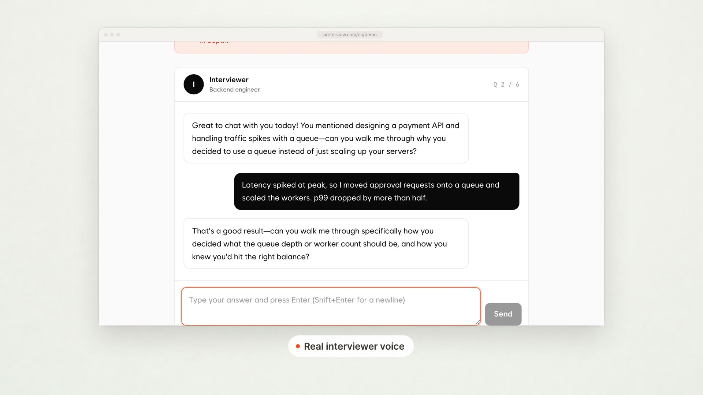

On a weeknight around 9:40, fourteen people finished a session in my app inside the same three minutes. Three of them never got their report. The logs had the same line over and over: `prepared statement "__asyncpg_stmt_1a__" already exists`.

I had added PgBouncer two days earlier to fix a connection limit problem. It fixed that one and introduced a new one. If you run asyncpg + PgBouncer transaction mode, this post is the autopsy I wish I had read first: why it fails only under load, why the obvious fix only gets you 85% of the way, and what actually got me to zero.

## TL;DR

- **asyncpg uses named prepared statements** (`__asyncpg_stmt_N__`). Those live on one Postgres server connection.
- **PgBouncer transaction mode** hands your next transaction to whichever server connection is free. Your statement name is now on the wrong connection, or collides with someone else's.
- **`statement_cache_size=0` alone was not enough** in my SQLAlchemy setup. Failures dropped from 61 to 9, not to 0, because SQLAlchemy's asyncpg dialect still calls `prepare()` with sequential names.
- **The fix that worked:** disable both caches *and* give every prepared statement a unique name with `prepared_statement_name_func`. Zero errors across the next 11,800 writes.
- **Cost:** p50 query time went from 3.1 ms to 3.6 ms because Postgres now re-parses every statement. I'll take it.

## What was the setup?

The backend is FastAPI, SQLAlchemy 2.x async, and asyncpg, talking to a managed Postgres instance with a hard cap of 100 connections. Each app worker held its own SQLAlchemy pool. Scale out to enough workers and the pools alone eat the cap, so I put PgBouncer in front in `pool_mode = transaction`.

The system is Preterview, an interview practice app I run (full disclosure: I built it). A session is a live voice conversation, and when it ends the backend writes the transcript, per-question scores, and a written report in one burst of inserts. That burst is the write path that broke.



Locally, everything passed. Staging passed. Production at quiet hours passed. The failures only showed up when a dozen sessions ended at once, which is exactly the moment you can't debug interactively.

## How bad was it?

In the first 48 hours behind PgBouncer, out of 2,140 session-end writes:

| Error | Count |
|---|---|
| `DuplicatePreparedStatementError: ... already exists` | 44 |
| `InvalidSQLStatementNameError: ... does not exist` | 17 |
| **Total failed writes** | **61 (2.9%)** |

Every single failure happened when concurrent session-end writes were above roughly 20 in flight. Below that, zero. That pattern is the whole clue.

## Why does asyncpg break behind PgBouncer transaction mode?

asyncpg breaks behind PgBouncer transaction mode because it prepares statements by name on a server connection, and PgBouncer doesn't promise you the same server connection twice. The statement name is client-side state pointing at server-side memory that may not be yours anymore.

Here's the sequence in slow motion:

1. Worker A runs `INSERT INTO reports ...`. asyncpg sends `PARSE` with the name `__asyncpg_stmt_1a__` on server connection S1. Postgres stores it on S1.
2. The transaction commits. PgBouncer returns S1 to its pool.
3. Worker A's next transaction gets server connection S2. asyncpg's cache says "I already prepared this as `__asyncpg_stmt_1a__`", so it sends `BIND` with that name. S2 has never heard of it. **"does not exist."**
4. Meanwhile Worker B, on its own fresh client connection, also counts from the same starting point. It lands on S1 and tries to `PARSE` a different query as `__asyncpg_stmt_1a__`. S1 already has one. **"already exists."**


With low concurrency, PgBouncer tends to hand back the same idle server connection, so the names line up by luck. Under load, connections get shuffled and the luck runs out. That's why it looked like a flaky bug instead of a configuration bug.

The asyncpg error message even says this. The hint attached to the exception tells you that PgBouncer in transaction or statement mode doesn't support prepared statements properly and suggests `statement_cache_size=0`. I had been reading only the first line of the traceback for two days.

## Does statement_cache_size=0 fix it?

Partly. Setting `statement_cache_size=0` stops asyncpg from reusing cached named statements across transactions, which kills most of the "does not exist" errors. In my setup it took failures from 61 to 9 over a comparable 48-hour window. Better, not fixed.

First attempt:

```python
engine = create_async_engine(
    DATABASE_URL,
    connect_args={"statement_cache_size": 0},
)
```

The remaining 9 were all "already exists." The reason: SQLAlchemy's asyncpg dialect keeps its *own* prepared statement cache (`prepared_statement_cache_size`), and it calls asyncpg's `prepare()` explicitly. Explicitly prepared statements still get the sequential `__asyncpg_stmt_N__` names. Two client connections counting from the same starting point, landing on the same server connection, still collide.

So there are two caches and one naming scheme to deal with. I had fixed one cache.

## What is the fix for asyncpg + PgBouncer prepared statement errors?

Disable both caches, and make every prepared statement name globally unique so collisions are impossible even when PgBouncer shuffles connections. SQLAlchemy 2.0 has a parameter built for exactly this: `prepared_statement_name_func`.

```python
from uuid import uuid4
from sqlalchemy.ext.asyncio import create_async_engine
from sqlalchemy.pool import NullPool

engine = create_async_engine(
    DATABASE_URL,  # points at PgBouncer, not Postgres
    poolclass=NullPool,  # PgBouncer is the pool now
    connect_args={
        "statement_cache_size": 0,              # asyncpg's cache
        "prepared_statement_cache_size": 0,     # SQLAlchemy's cache
        "prepared_statement_name_func": lambda: f"__asyncpg_{uuid4()}__",
    },
)
```

Three changes, each for a separate reason:

- **`statement_cache_size=0`** stops asyncpg from assuming a statement prepared earlier still exists.
- **`prepared_statement_cache_size=0`** does the same for SQLAlchemy's layer.
- **`prepared_statement_name_func`** replaces `__asyncpg_stmt_1a__` with a UUID. Two workers can no longer pick the same name, so "already exists" becomes mathematically boring.

I also switched to `NullPool`. Running a SQLAlchemy pool on top of PgBouncer is double pooling: app-side connections sit idle holding PgBouncer client slots, and you get none of the multiplexing you added PgBouncer for. With `NullPool`, each checkout opens a cheap client connection to PgBouncer and closes it after.

Result: **0 prepared statement errors across the next 7 days and 11,800 session-end writes**, including two evenings with more than 30 concurrent writes.


## What does disabling prepared statements cost?

Every query now gets parsed and planned fresh instead of reusing a plan. For my workload, short inserts and indexed lookups, p50 query time went from 3.1 ms to 3.6 ms and p99 from 14 ms to 17 ms. The session-end burst is about 40 statements, so that's roughly 20 ms added to a write the user never waits on.

If your workload is heavy, repeated, complex queries, the parse cost could matter more. Measure your own p99 before and after rather than trusting my numbers.

## Is there a fix on the PgBouncer side?

Yes. Newer PgBouncer versions (1.21 and later) can track protocol-level named prepared statements in transaction mode via `max_prepared_statements`. PgBouncer rewrites statement names and re-prepares them on whichever server connection you land on. I had to set it explicitly; it did nothing until I did.

```ini
[pgbouncer]
pool_mode = transaction
max_prepared_statements = 200
```

I tested this on staging and it also got the errors to zero, with the plan-caching benefit back. I still ship the client-side config in production for one reason: my managed Postgres provider controls the PgBouncer version, and I don't want correctness depending on a setting I can't see. If you own your PgBouncer, the server-side option is the better long-term answer.

## What I'd check first next time

- **Read the whole exception, including the hint.** asyncpg told me the answer on day one.
- **Reproduce with concurrency, not with retries.** A single client never triggers this. I wrote a 40-coroutine script that fires the session-end write in parallel against staging PgBouncer, and it reproduced the bug in under a minute. Before that I had spent an evening adding retry logic, which turned 3% failures into 3% duplicate partial writes.
- **Count your caches.** asyncpg has one, SQLAlchemy has one. Any ORM wrapping a driver may add another.
- **Never let session-level state cross PgBouncer transaction mode.** Prepared statements are the famous one. `SET` without `LOCAL`, advisory locks, `LISTEN`, and temp tables break the same way.

## So why does asyncpg throw "prepared statement already exists" behind PgBouncer?

Because asyncpg + PgBouncer transaction mode puts named, per-connection prepared statements on top of a pooler that reassigns server connections between transactions. Your statement name points at a connection you no longer own, or collides with another client's identical sequential name on the connection you got. The fix that took my production errors from 61 to 0: set `statement_cache_size=0` and `prepared_statement_cache_size=0`, give prepared statements unique names with `prepared_statement_name_func` (UUIDs work), and drop app-side pooling with `NullPool`. If you control PgBouncer 1.21+, `max_prepared_statements` solves it on the server side and keeps plan caching. Expect a small parse cost; mine was 0.5 ms at p50.

---

*Written by the developer behind [Preterview](https://preterview.com/en), an interview prep platform.*
