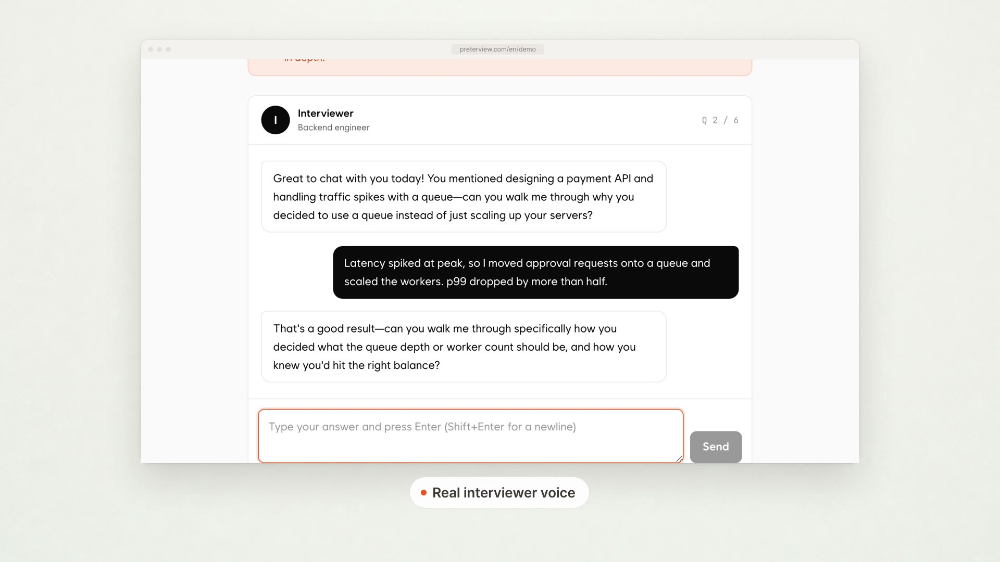

Nine people emailed me the same screenshot: a spinner and the line "Your report is being prepared." One of them had been looking at it for 51 hours.

The report was done. It had been done since about 40 seconds after their session ended. It was sitting in object storage as a perfectly normal-looking file. The problem was three characters inside it: `NaN`. **Python json.dumps writes NaN by default**, the browser's `JSON.parse` refuses to read it, and my pipeline had no step anywhere that cared about the difference.

## TL;DR

- Python's `json.dumps` has `allow_nan=True` by default, so `float('nan')` becomes a bare `NaN` token. That is not valid JSON.
- Python's own `json.loads` reads `NaN` back without complaint, so round-trip tests pass. JavaScript's `JSON.parse` throws a `SyntaxError`.
- My NaN came from `np.nanmean` over a rubric category where the LLM scorer returned `null` for every answer. An all-NaN slice returns NaN and only emits a `RuntimeWarning`.
- 31 of 1,940 reports (1.6%) over 16 days were unreadable. 26 of the 31 came from one interviewer style.
- Fix: score fields as `Optional[float]` with `allow_inf_nan=False` in Pydantic, plus `json.dumps(..., allow_nan=False)` as a tripwire at every write.

## What broke?

The system is Preterview, an interview practice platform I run (full disclosure: I built it, [preterview.com/en](https://preterview.com/en)). A candidate does a voice interview with one of three interviewer styles, an LLM scores each answer against a rubric, and a worker assembles everything into a written report.



The report pipeline looks like this:

1. The LLM scores each answer per rubric category (communication, technical depth, structure, and so on) and returns structured JSON.
2. A Python worker aggregates scores per category.
3. The worker writes `report.json` to object storage.
4. The frontend fetches that file directly and renders it.

Step 4 is where 31 reports died. The fetch succeeded, `JSON.parse` threw, my error handler caught it, and the error handler's fallback was "show the preparing state and poll again." Forever. I had built a very polite infinite loop.

## Where did the NaN come from?

The NaN came from averaging a category that had no scores at all. The scorer prompt allows the model to say "I can't assess this category from this answer" by returning `null`. That's deliberate. I'd rather get a `null` than a confident 6/10 for system design on an answer about a team conflict.

The aggregation code turned those nulls into NaN on purpose so they'd be skipped:

```python
import numpy as np

def category_mean(scores: list[float | None]) -> float:
    arr = np.array([np.nan if s is None else s for s in scores], dtype=float)
    return float(np.nanmean(arr))
```

`np.nanmean` ignores NaN values. That's what I wanted. What I hadn't thought through is what it does when *every* value is NaN:

```python
>>> np.nanmean([np.nan, np.nan, np.nan])
RuntimeWarning: Mean of empty slice
nan
```

No exception. A warning and a NaN.

When does every answer in a category get `null`? When the interviewer never asks a question that touches that category. One of my three interviewer styles is a conversational, culture-fit style. It often runs a whole session without a single technical question. So the "technical depth" category came back all-null, `nanmean` returned NaN, and the NaN flowed downstream. That's why 26 of the 31 broken reports came from that one style.


## Why does Python json.dumps write NaN by default?

Because `allow_nan` defaults to `True`. The Python docs are upfront about it: with `allow_nan=True`, out-of-range floats are written as their JavaScript equivalents (`NaN`, `Infinity`, `-Infinity`), and the docs note this is not strictly JSON compliant. RFC 8259 has no representation for NaN at all.

```python
>>> import json
>>> json.dumps({"technical_depth": float("nan")})
'{"technical_depth": NaN}'
```

The part that let this survive testing: Python reads it back just fine.

```python
>>> json.loads('{"technical_depth": NaN}')
{'technical_depth': nan}
```

My test suite had a round-trip test: build a report, dump it, load it, compare. Python on both ends, so it passed. The only consumer that enforced the actual JSON spec was the browser:

```js
JSON.parse('{"technical_depth": NaN}')
// SyntaxError: Unexpected token 'N'
```

## Why didn't my logs show anything?

Two reasons, and both are defaults.

First, Python's default warnings filter shows a given warning once per code location, not once per occurrence. My workers are long-running processes. The first all-null category after a deploy printed `Mean of empty slice` to stderr. The next 30 printed nothing. Across 16 days I found 11 instances of that warning in the logs, one per worker start, sitting between thousands of normal lines. Nothing about it said "a user's report is broken."

Second, the worker considered the job successful. `json.dumps` returned a string, the upload returned 200, the job was marked done. From the backend's point of view, every one of the 1,940 reports succeeded.

There was one more trap I tripped over while debugging. My first attempt to display the score did this:

```python
>>> round(float("nan"))
ValueError: cannot convert float NaN to integer
```

But `round(float("nan"), 1)` quietly returns `nan`. The report used one decimal place, so this path never raised either. Every layer had a way to pass NaN along without anyone noticing.

## Which serializers accept NaN and which reject it?

This is the table I wish I'd had. Same input, `float("nan")`, very different behavior:

| Where | What happens |
|---|---|
| `json.dumps` (stdlib) | Writes `NaN`. Invalid JSON, no error |
| `json.dumps(..., allow_nan=False)` | Raises `ValueError` |
| `json.loads` (stdlib) | Accepts `NaN`, returns `nan` |
| Starlette / FastAPI `JSONResponse` | Raises `ValueError` (it uses `allow_nan=False`) |
| Pydantic v2 `model_dump_json()` | Writes `null` by default (`ser_json_inf_nan`) |
| orjson | Writes `null` |
| Postgres `jsonb` | Rejects the input as invalid JSON |
| Browser `JSON.parse` | Throws `SyntaxError` |

The irony: if this report had gone through my FastAPI endpoint, it would have been a loud 500 on day one. If I'd stored it in a `jsonb` column, the insert would have failed. I chose to write it straight to object storage with the stdlib serializer, which happens to be the most permissive path in the whole table.

Also notice that "writes `null`" is not automatically safe. Pydantic and orjson would have produced valid JSON, but the frontend would then have rendered "Technical depth: null" or crashed on `null.toFixed(1)`. Valid syntax, wrong meaning.


## How do you stop NaN from reaching your JSON?

Make "not assessed" a real value instead of a float that pretends to be a number. Then make every serializer refuse NaN so the next mistake fails at write time, not in a user's browser.

The model change:

```python
from pydantic import BaseModel, Field

class CategoryScore(BaseModel):
    category: str
    mean: float | None = Field(default=None, allow_inf_nan=False)
    assessed_answers: int
```

And the aggregation stops producing NaN in the first place:

```python
def category_mean(scores: list[float | None]) -> float | None:
    vals = [s for s in scores if s is not None]
    return sum(vals) / len(vals) if vals else None
```

No numpy, no warning, and the empty case is a branch you can read instead of a side effect you have to remember.

Then the tripwire, at the single function that writes report files:

```python
payload = json.dumps(report.model_dump(), allow_nan=False)
```

If anything upstream ever sneaks a NaN or an Infinity back in, this raises, the job fails, and my alerting sees a failed job instead of a successful one.

Two smaller changes:

- **Tests run with warnings as errors.** `filterwarnings = error::RuntimeWarning` in pytest config. The "Mean of empty slice" warning would have failed CI on the first test with a skipped category, and I had one. It just never asserted anything about the output.
- **The frontend stops polling on parse errors.** A `SyntaxError` is not "still preparing." It now shows an error state and pings me.

The frontend change was really the bigger lesson. The NaN was a bug. The spinner turned that bug into 51 hours of a user waiting for something that was never going to arrive.

## How did I recover the 31 broken reports?

I re-ran aggregation only. The raw per-answer LLM scores were stored separately from the assembled report, so I didn't need a single new model call. All 31 reports rebuilt and rendered in under two minutes, with "Technical depth: not assessed in this session" where the NaN used to be. I emailed the nine people who'd written in, plus the other 22 who'd quietly given up.

If I'd only stored the final report, I'd have had to re-score 31 sessions and explain why their scores changed. Keep your raw LLM outputs. You will need to re-derive something from them eventually.

## Does Python json.dumps write NaN by default?

Yes. Python's `json.dumps` uses `allow_nan=True` by default, so `float('nan')` is written as a bare `NaN` token, which is not valid JSON under RFC 8259. Python's `json.loads` accepts it back, so Python-only tests won't catch it, but JavaScript's `JSON.parse`, Postgres `jsonb`, and most strict parsers will reject the file. Pass `allow_nan=False` to make serialization raise a `ValueError` instead, and represent missing numeric values as `None`/`null` explicitly, especially for LLM-generated scores where "couldn't assess" is a legitimate answer that averaging code will happily turn into NaN.

---

*Written by the developer behind [Preterview](https://preterview.com/en), an interview prep platform.*
