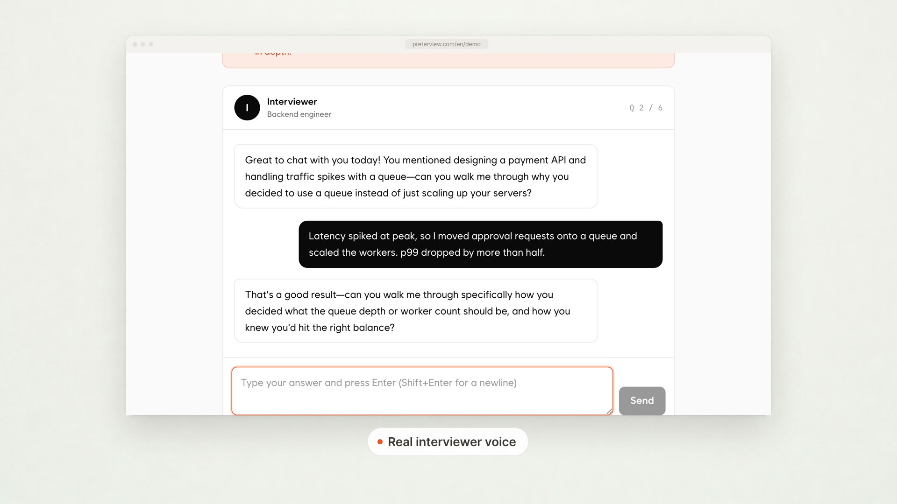

A user's transcript said "Thank you." in the middle of an answer about database indexing. They never said it. They paused for four seconds to think, and Whisper filled the silence with a polite sentence that didn't exist.

That one line sent me on a two-day audit. The short version: **Whisper hallucinates on silence**, my default settings let it through, and the parameter that sounds like it should stop this (`no_speech_threshold`) has a catch most people miss.

## TL;DR

- I fed Whisper large-v3 (via faster-whisper) 700 audio chunks that I had verified were pure silence or room noise. **61 of them (8.7%) came back with text.**
- The top outputs: "Thank you." (34), "Thanks for watching!" (9), a lone "you" (8), a repeat of the previous sentence (6), and subtitle-credit style lines (4).
- `no_speech_threshold` didn't save me because Whisper only skips a segment when `no_speech_prob` is high **AND** `avg_logprob` is low. A confident hallucination passes the second test.
- Three fixes took it from 61 to 3: a VAD gate before Whisper, `condition_on_previous_text=False`, and a narrow phrase filter that only fires when `no_speech_prob` is high.
- The VAD gate cost me 2 real answers out of 300 short ones. Every fix here trades something.

## Where did the fake "Thank you" come from?

The system is Preterview, a voice interview practice tool I built and run (full disclosure: I built it, it's at [preterview.com/en](https://preterview.com/en)). It runs spoken mock interviews with three interviewer styles, and an LLM scores the transcript into a written report. That means the transcript is the ground truth for everything downstream. If Whisper invents a sentence, the scorer reads it, and the interviewer model might react to it.



People pause a lot in interviews. They think, they breathe, they say "hmm" and stop. My pipeline chunked the stream on pauses and sent each chunk to faster-whisper. Most chunks had speech. Some were just the hum of someone's laptop fan while they gathered their thoughts.

Those were the ones producing ghosts.

## How I measured Whisper hallucination on silent audio

I pulled chunks from sessions where users had opted in to recordings being used for quality checks. Then I filtered for chunks whose RMS energy stayed under a floor for the full duration, and I listened to every candidate myself to confirm there was no speech. Not a whisper, not a cough with a word in it. I ended up with 700 confirmed-silent chunks, 1.5 to 6 seconds long.

Then I ran them through the exact config production was using:

```python
from faster_whisper import WhisperModel

model = WhisperModel("large-v3", device="cuda", compute_type="float16")

segments, info = model.transcribe(
    chunk_path,
    language="en",
    beam_size=5,
    # library defaults, spelled out so I can see them
    no_speech_threshold=0.6,
    log_prob_threshold=-1.0,
    compression_ratio_threshold=2.4,
    condition_on_previous_text=True,
)
```

Expected output for silence: nothing. Actual output: 61 chunks with text.

| Output | Count |
|---|---|
| "Thank you." | 34 |
| "Thanks for watching!" | 9 |
| "you" | 8 |
| Repeat of the previous chunk's sentence | 6 |
| Subtitle-credit style line | 4 |

"Thanks for watching!" is the giveaway. Whisper was trained on a huge amount of web audio paired with captions, and the silent tail of a video is exactly where a human captioner types an outro. The model learned that quiet audio at the end of something usually means "Thank you." It's not broken. It's doing what its training data taught it.


## Why doesn't no_speech_threshold stop Whisper from hallucinating?

Because it isn't a standalone gate. Whisper skips a segment as silence only when **both** conditions hold: `no_speech_prob > no_speech_threshold` **and** `avg_logprob < log_prob_threshold`. If the model is confident about the text it generated, the second condition fails and the segment is kept.

I logged both values for the 61 hallucinations:

- 49 had `no_speech_prob` above 0.6. The model itself thought there was probably no speech.
- Of those 49, 44 had `avg_logprob` above -1.0. The decoder was confident about "Thank you." anyway.

So the model was saying "this is probably silence" and "I'm very sure the words are Thank you" at the same time, and the AND rule let the confident half win. "Thank you." is a short, extremely common token sequence. Of course the log probability is high.

The other 12 hallucinations had `no_speech_prob` below 0.6, which means no threshold tuning on that knob would have caught them.


## What is condition_on_previous_text doing to silent chunks?

`condition_on_previous_text=True` feeds the previous transcript in as a prompt for the next window. On real speech that helps with consistency. On silence it gives the decoder something to copy. Six of my hallucinations were the previous chunk's last sentence, repeated word for word, on audio that contained nothing.

Setting it to `False` killed all 6 repeats. I checked 300 normal speech chunks before and after, and the word-level diff on those was small enough that I couldn't tell which version was better by reading them.

## How do you stop Whisper hallucinating on silence?

Stop sending it silence, stop giving it text to copy, and filter the known phrases only when the model already suspects silence. Here's what each fix did, applied in order on the same 700 chunks:

**1. VAD gate before Whisper: 61 to 9.** faster-whisper ships a Silero-based VAD filter. I turned it on so silent chunks never reach the decoder:

```python
segments, info = model.transcribe(
    chunk_path,
    language="en",
    beam_size=5,
    vad_filter=True,
    vad_parameters={"min_silence_duration_ms": 500},
    condition_on_previous_text=False,
)
```

**2. `condition_on_previous_text=False`: 9 to 7.** Most repeats were already gone after the VAD gate, but two survived on chunks with faint noise the VAD read as speech.

**3. A narrow phrase filter: 7 to 3.** I drop a segment only if the text matches a short list of known outro phrases **and** its `no_speech_prob` is above 0.5:

```python
GHOSTS = {"thank you.", "thanks for watching!", "you", "thank you for watching."}

def keep(seg):
    text = seg.text.strip().lower()
    if text in GHOSTS and seg.no_speech_prob > 0.5:
        return False
    return True
```

The `no_speech_prob` condition matters. People really do say "thank you" at the end of an interview. Without it, I'd be deleting real gratitude.

The last 3 hallucinations were noise-heavy chunks (a door, a chair) that produced single words like "Okay." I left those alone. Filtering every short word is how you start deleting real answers.

## What did the fixes break?

The VAD gate is the expensive one. I ran 300 real chunks where the user's whole answer was short and quiet ("um, yes", "no, not really", a soft "correct"). With `vad_filter=True`, **2 of 300 were dropped entirely.** Both were very soft one-word answers after a long pause.

For my use case, a missing "yes" is better than an invented "Thank you." A fake sentence pollutes the scoring report. A missing one-word answer shows up as an unanswered question, which the interviewer model already handles by asking again. Your tradeoff might go the other way. If you transcribe legal or medical audio, test this on your own quiet speakers before you ship it.

The phrase filter dropped 0 of 41 real end-of-session "thank you"s, because real speech had `no_speech_prob` well under 0.5 in every case I checked.

One side effect I liked: with the VAD gate on, about 18% less audio reached the GPU, because silent chunks stopped going to the decoder at all. Fewer ghosts and a smaller bill.

## What I'd check first if your transcripts have phantom text

1. Grep your transcripts for "Thank you." and "Thanks for watching" on chunks under 3 seconds. That's the cheapest smoke test there is.
2. Log `no_speech_prob` and `avg_logprob` per segment. If you see high values on both, you're looking at a confident hallucination, and threshold tuning alone won't fix it.
3. Turn on a VAD gate, then measure what it drops on your quietest real speakers.
4. Turn off `condition_on_previous_text` for short, pause-split chunks.
5. Filter known phrases only alongside a `no_speech_prob` check, never on text alone.

I also looked at `hallucination_silence_threshold`, which skips silent gaps around suspected hallucinations. It requires `word_timestamps=True`, which added latency I didn't want on a live voice turn, so I didn't ship it. On long-form batch transcription I'd try it first.

## Why does Whisper hallucinate on silence?

Whisper hallucinates on silence because it was trained on captioned web audio where quiet stretches often carry outro text like "Thank you" or "Thanks for watching," and its silence skip rule requires both a high `no_speech_prob` and a low `avg_logprob`, so a confident short phrase gets through. In my test, 61 of 700 verified-silent chunks produced text with default settings. Putting a VAD gate in front, disabling `condition_on_previous_text`, and filtering known phrases only when `no_speech_prob` is high brought that down to 3, at the cost of 2 dropped real answers out of 300 quiet ones.

---

*Written by the developer behind [Preterview](https://preterview.com/en), an interview prep platform.*
