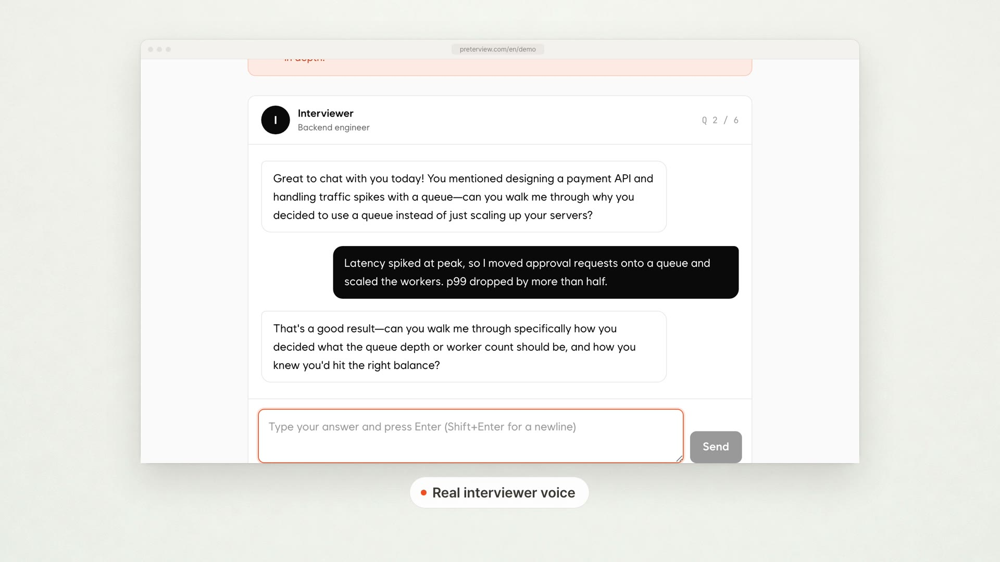

The candidate said, "The main reason we moved off Redis was..." and then stopped to think.

Seven hundred milliseconds later, my voice bot decided they were done talking. It generated a follow-up question, started speaking it, and got talked over two seconds later when the person finished their sentence. Barge-in handling cancelled the audio. The LLM call was wasted. And the transcript that got scored was half an answer.

That was my Silero VAD end-of-turn logic working exactly as configured. I replayed 1,000 recorded answer turns through it offline to see how often it happened. The answer was 118 times. Here's the test, the threshold sweep, and the fix that got it down to 21 without making the bot feel slow.

## TL;DR

- A fixed 700ms silence window for **Silero VAD end-of-turn** detection cut off **118 of 1,000** spoken answers (11.8%) in my replay test.
- Raising the window helps but costs latency on every turn: 1,500ms got cutoffs down to 24, but every answer then waited 1.5 seconds for a reply.
- **100 of the 118** cutoffs happened when the partial transcript ended in a conjunction, a filler word, a trailing comma, or a list opener like "First".
- An adaptive window (700ms normally, 2,000ms when the transcript tail looks unfinished) cut premature end-of-turns to **21** with the median wait unchanged at 700ms.
- Silence alone can't tell "done" from "thinking". The words before the silence usually can.

## Where this came from

This is from Preterview, a voice interview practice app I run (full disclosure: I built it). You talk to an AI interviewer out loud, it asks follow-ups, and at the end it scores the answers and writes a report. Pauses are the whole problem there, because people being interviewed pause constantly. You can see what a session looks like at [preterview.com/en](https://preterview.com/en).



Casual voice chat is forgiving. Interview answers are not. People stop mid-sentence to recall a number, pick a word, or decide whether to admit something went badly. Those are exactly the pauses a silence timer reads as "I'm finished".

## How does Silero VAD end-of-turn detection work?

Silero VAD returns a speech probability for each small audio chunk (512 samples at 16 kHz, so 32ms). End-of-turn is a rule you layer on top: if probability stays under a threshold for N milliseconds, the speaker is done. The `VADIterator` helper bakes this in with `min_silence_duration_ms`.

My original version was about this simple:

```python
from silero_vad import load_silero_vad, VADIterator

model = load_silero_vad()
vad = VADIterator(
    model,
    threshold=0.5,
    sampling_rate=16000,
    min_silence_duration_ms=700,
)

for chunk in mic_chunks(512):  # 32ms of 16 kHz audio
    event = vad(chunk)
    if event and "end" in event:
        end_turn()  # send transcript to the LLM, start the reply
```

There is nothing wrong with this code. Silero is doing its job: the person really was silent for 700ms. The bug is the assumption that 700ms of silence means the turn is over.

## How I measured premature end-of-turns

I didn't want to hand-label 1,000 recordings, so I used a mechanical definition:

> A **premature end-of-turn** is any point where the rule fires `end`, and speech resumes within 3 seconds.

If you're "done" and then keep talking within 3 seconds, you weren't done. This undercounts a little (some people resume after 4 seconds) and overcounts a little (some people really do add a second thought). But it's consistent across every setting, which is what a sweep needs.

The dataset was 1,000 answer turns from opt-in sessions and my own test accounts. I replayed the raw audio through the same chunking and VAD code, offline, with no network or TTS in the loop. That matters for the caveat at the end.

## What silence threshold should a voice bot use for end-of-turn?

There isn't a good fixed one. Every value trades cutoffs against reply latency, because the silence window gets added to the wait on *every* turn, including the ones that really are over.

Here's the sweep:

| Silence window | Premature end-of-turns (of 1,000) | Wait after a real ending |
|---|---|---|
| 500ms | 231 | 500ms |
| 700ms (what I shipped) | 118 | 700ms |
| 1,000ms | 62 | 1,000ms |
| 1,500ms | 24 | 1,500ms |
| Adaptive (700 / 2,000ms) | 21 | 700ms median |

1,500ms looks great on cutoffs. In practice it feels broken. You finish a sentence, and the interviewer just sits there for a second and a half before the LLM even starts. Add model time-to-first-token and TTS startup on top, and the gap is long enough that people say "hello?"


## Why do voice bots cut people off mid-sentence?

Because the cut happens at the moment the speaker is *most* likely to pause: right before the hard part of the sentence. I pulled the streaming STT partial transcript at the instant each of the 118 cutoffs fired and looked at the last few words.

- **74** ended in a conjunction or filler: "and", "so", "because", "but", "um", "like", "which".
- **26** ended in an obvious opener: a trailing comma, "First", "The reason was", "There were three".
- **18** ended in a complete sentence. The person stopped, thought, and added a second point.

That's 100 of 118 where the words themselves were shouting "not done yet". Nobody ends an answer on "because".

The 18 complete-sentence cases are the honest limit. "We migrated in two weeks." followed by a long breath and "Actually, the rollback took another week." No rule on the text catches that, and I'm not sure it should. Interrupting after a complete sentence is something a human interviewer does too.

## The fix: an adaptive end-of-turn window

Instead of one silence window, I pick the window from the tail of the partial transcript. Silero only tells me *when* silence starts. My own timer decides when it's long enough.

```python
INCOMPLETE_TAIL = {
    "and", "so", "because", "but", "or", "um", "uh", "like",
    "which", "that", "the", "a", "to", "of", "first", "then",
}

def silence_budget_ms(partial: str) -> int:
    text = partial.strip().lower()
    if not text:
        return 2000              # nothing said yet: they're still starting
    if text.endswith((",", "...")):
        return 2000
    last = text.split()[-1].strip(".,!?")
    if last in INCOMPLETE_TAIL:
        return 2000
    return 700


vad = VADIterator(model, threshold=0.5, sampling_rate=16000,
                  min_silence_duration_ms=100)
silence_started = None

for chunk in mic_chunks(512):
    event = vad(chunk)
    if event and "start" in event:
        silence_started = None
    elif event and "end" in event:
        silence_started = now_ms()
    if silence_started is not None:
        if now_ms() - silence_started >= silence_budget_ms(stt.partial()):
            end_turn()
            silence_started = None
```

The VAD now reports silence starts after 100ms. My code decides whether that silence is a full stop or a breath.

Results on the same 1,000 turns:

- Premature end-of-turns: **118 → 21**. That's the 18 complete-sentence cases plus 3 misses where the transcript tail hadn't caught up yet.
- Median wait after a real ending: **700ms, unchanged**. Most answers end on a complete sentence, so most turns still use the short window.
- The tail cost: about 1 in 10 real endings now waits 2 seconds, mostly people who trail off with "so, yeah" and stop. That one stings a bit. "Yeah" isn't in the list, but "so" lands right before it often enough.


## What I tried that didn't work

**Lowering the Silero threshold.** I tried 0.35 to make soft trailing syllables count as speech. It barely moved cutoffs, because the problem was real silence, not quiet speech. It did start counting keyboard clicks as speech.

**Asking a small LLM "is this sentence finished?"** It was more accurate than my word list on paper. But it runs in the critical path at the worst possible moment, and the round trip ate more latency than the adaptive window saved. A set lookup takes microseconds.

**Just letting barge-in clean it up.** Barge-in stops the TTS, but the damage is done. The LLM already answered half an answer, and my scoring pipeline was grading the fragment. Split answers scored lower than the same person's unsplit answers, which is a scoring bug caused by an audio bug.

## The caveat

This was an offline replay, not live traffic. In production, the STT partial lags the audio by a few hundred milliseconds, so the transcript tail is sometimes stale when the timer checks it. Those were the 3 misses in my run, and live it will probably be a few more. The word list is also English-only. A language where the verb comes last breaks the assumption that the last word tells you much.

## So does a 700ms silence window work for Silero VAD end-of-turn?

Not for long-form spoken answers. In my replay of 1,000 answers, a fixed 700ms silence window for Silero VAD end-of-turn detection cut people off 118 times, mostly right after words like "and", "because" and "so". Making the window longer fixes cutoffs only by slowing every reply. The better approach is to keep Silero for detecting *when* silence starts, then choose the silence budget from the partial transcript: short when the last words form a finished sentence, around 2 seconds when they end in a conjunction, filler or comma. That took my premature end-of-turns from 118 to 21 with no change to median reply latency.

---

*Written by the developer behind [Preterview](https://preterview.com/en), an interview prep platform.*
