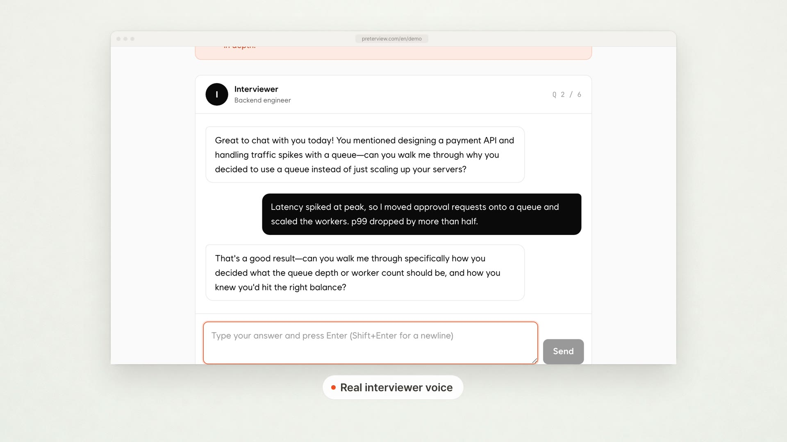

I wrote `LIMIT 10`. Postgres returned 3 rows. There was no error, no warning and no log line, and for five weeks I didn't notice, because my own fallback code covered for it.

This post is about **pgvector HNSW filtering**: what happens when you put a `WHERE` clause on an approximate nearest neighbor query. Short version: the index finds its neighbors first and your filter runs afterward. If most of those neighbors fail the filter, you get fewer rows than you asked for, and nothing tells you.

## TL;DR

- pgvector's HNSW index collects `hnsw.ef_search` candidates (default **40**), and only then does Postgres apply your `WHERE` filter. When the filter rejects most of them, the query returns fewer than `LIMIT` rows without any error.
- In a replay of 2,000 production queries, **431 (21.6%)** returned fewer than 10 rows and **97** returned zero.
- Raising `hnsw.ef_search` to 200 cut short results to 63. pgvector 0.8's `hnsw.iterative_scan = relaxed_order` cut them to 9, and those 9 were correct answers (the category didn't have 10 rows in total).
- The worst-hit categories were mid-sized ones that sit close in embedding space to a bigger category. The tiniest categories mostly escaped because the planner skipped HNSW for them.
- Check `len(rows) < limit` in application code. The database will never flag it.

## What was I building?

The system is the question retriever inside Preterview, a voice mock-interview platform I run that has three interviewer styles and writes a report after each session (full disclosure: I built it, and it's at [preterview.com/en](https://preterview.com/en)). Before each interviewer turn, an agent pulls 10 candidate follow-up questions for the candidate's target role, and an LLM picks one based on the conversation so far.



The table looked like this:

- 52,000 questions
- 140 role tags (`backend_engineer`, `data_engineer`, `sre`, `ios_engineer`, ...)
- `embedding vector(1024)` with an HNSW index on default build settings (`m = 16`, `ef_construction = 64`)
- a plain btree index on `role`

The query was the one every tutorial shows:

```sql
SELECT id, body
FROM interview_questions
WHERE role = $2
ORDER BY embedding <=> $1
LIMIT 10;
```

And here's the part I'm least proud of. If the retriever got fewer than 10 rows back, it padded the list from a pool of 30 general questions. I'd written that for brand-new roles with tiny question banks. In practice it hid the bug: users preparing for data engineering roles got the same three general questions about "a project you're proud of" session after session. The complaint I eventually got was "the interviewer feels repetitive." It didn't look like a retrieval bug at all.

## Why does pgvector HNSW return fewer rows than LIMIT?

pgvector's HNSW index scan returns at most `hnsw.ef_search` nearest candidates (40 by default), and Postgres applies the `WHERE` clause to those candidates after the scan. If 37 of the 40 nearest questions belong to another role, you get 3 rows, even though thousands of matching rows exist in the table.

`EXPLAIN ANALYZE` shows exactly this once you know where to look:

```
Limit  (actual rows=3 loops=1)
  ->  Index Scan using questions_embedding_idx on interview_questions
        Order By: (embedding <=> '[...]'::vector)
        Filter: (role = 'data_engineer'::text)
        Rows Removed by Filter: 37
```

40 candidates, 37 removed, 3 left. Postgres didn't fail at anything. It did exactly what the index promised: an approximate top 40, then a filter.


## Which filtered vector queries get hit hardest?

Mid-sized categories that are semantically close to a large category get hit hardest. The trouble isn't that a role is rare. It's that its nearest neighbors in embedding space mostly belong to some other role.

I replayed 2,000 real retrieval calls from logs against a copy of the table and bucketed them:

| Role bucket | Queries | Came back short |
|---|---|---|
| Large roles (more than 3% of rows each) | 1,020 | 12 |
| Mid roles, close to a large role | 610 | 379 |
| Mid roles, semantically distinct | 240 | 31 |
| Tiny roles (under 0.2% of rows) | 130 | 9 |
| **Total** | **2,000** | **431** |

`data_engineer` was the poster child. Its questions about pipelines, partitioning and backfills sit right next to `backend_engineer` questions about queues, partitioning and retries, and backend had roughly six times as many rows. So the 40 nearest neighbors of a data engineering query were mostly backend questions. `sre` lost to `devops` the same way.

Meanwhile `embedded_firmware` was fine at the same size, because nothing else in the table talks about interrupt handlers.

The tiny roles surprised me. They mostly worked, because for a highly selective filter the planner used the btree on `role`, fetched every matching row and sorted them exactly by distance. No HNSW, no candidate cap. All 9 short results in that bucket came from roles with fewer than 10 questions in total, which is the right answer.

So the failure curve is U-shaped. Big roles win the neighbor vote. Tiny roles skip the index. The ones in the middle fall through the gap.

## Does raising hnsw.ef_search fix it?

Raising `hnsw.ef_search` reduces short results but doesn't remove them, and it makes every query slower, including the ones that were already fine. Here's the same 2,000-query replay on my box:

| Setting | Short | Zero rows | p50 | p99 |
|---|---|---|---|---|
| `ef_search = 40` (default) | 431 | 97 | 4.1 ms | 9 ms |
| `ef_search = 100` | 168 | 22 | 5.0 ms | 13 ms |
| `ef_search = 200` | 63 | 4 | 6.8 ms | 19 ms |
| `ef_search = 1000` (max) | 14 | 0 | 19.5 ms | 41 ms |
| `iterative_scan = relaxed_order` | 9 | 0 | 5.2 ms | 31 ms |

Even at the maximum of 1000, 5 queries still came back short of what the table could provide. A bigger fixed candidate pool is still a fixed candidate pool.

## How does pgvector iterative index scan work?

pgvector 0.8.0 added iterative index scans: when the filter leaves too few rows, the scan keeps walking the graph and fetching more candidates until it fills the `LIMIT` or hits `hnsw.max_scan_tuples` (20,000 by default). You turn it on per session or per transaction:

- `strict_order` keeps results exactly ordered by distance.
- `relaxed_order` allows slight reordering and is faster, so you re-sort at the end.

This is what I shipped:

```sql
BEGIN;
SET LOCAL hnsw.iterative_scan = relaxed_order;
SET LOCAL hnsw.ef_search = 100;

WITH candidates AS MATERIALIZED (
  SELECT id, body, embedding <=> $1 AS distance
  FROM interview_questions
  WHERE role = $2
  ORDER BY distance
  LIMIT 10
)
SELECT id, body FROM candidates ORDER BY distance;
COMMIT;
```

Two details matter here. `SET LOCAL` scopes the setting to the transaction, so it doesn't leak into other queries on a pooled connection. And the `MATERIALIZED` CTE plus the outer `ORDER BY` fixes the small reordering that `relaxed_order` allows.

The p99 jump from 9 ms to 31 ms comes from the worst queries, the data engineering ones that have to walk deep into backend territory before they find 10 matches. Median latency barely moved. For a voice interview where an LLM call comes right after this query, 31 ms at p99 doesn't register.


## Why is checking the row count still required?

Iterative scans stop at `hnsw.max_scan_tuples`, so a very unlucky filter can still come back short, and the database still won't raise an error. The only reliable signal is in your code:

```python
rows = await conn.fetch(QUERY, embedding, role)
if len(rows) < LIMIT:
    metrics.increment("retrieval.short", tags={"role": role})
    log.warning("short_retrieval", role=role, got=len(rows), want=LIMIT)
```

I kept the padding fallback, but now it fires a metric. If it fires for any role with more than 10 questions in the bank, that's a bug, not a cold start.

## Should you use partial indexes instead?

A partial HNSW index per category (`CREATE INDEX ... WHERE role = 'data_engineer'`) makes filtered search exact for that category, and it's the right fix if you filter on a handful of values. With 140 roles that's 140 indexes to build and maintain, so I only considered it for the two worst roles and found iterative scan was good enough. If your filter has 3 to 5 values, partitioning by that column is also a clean answer.

## What did this bug actually cost?

- **5 weeks** live before I found it, all hidden behind a fallback I wrote myself
- **one afternoon** to build the replay harness and get the numbers above
- **4 lines of SQL** to fix it, plus 4 lines of Python to make sure I see it next time

The expensive part wasn't the fix. It was a symptom that looked like bad LLM output when the cause was the database quietly returning less than I asked for.

## So why does pgvector HNSW filtering return fewer rows than LIMIT?

Because pgvector's HNSW index scan fetches only `hnsw.ef_search` candidates (40 by default) and Postgres applies your `WHERE` filter afterward, so a selective filter can leave you with 3 rows, or none, out of a `LIMIT 10`, with no error. It hurts most when the filtered category sits close in embedding space to a larger one. Raising `ef_search` helps partially at a latency cost. On pgvector 0.8 or later, set `hnsw.iterative_scan = relaxed_order` inside the transaction, re-sort in a materialized CTE, and always check the returned row count in code, because the database won't do it for you.

---

*Written by the developer behind [Preterview](https://preterview.com/en), an interview prep platform.*
