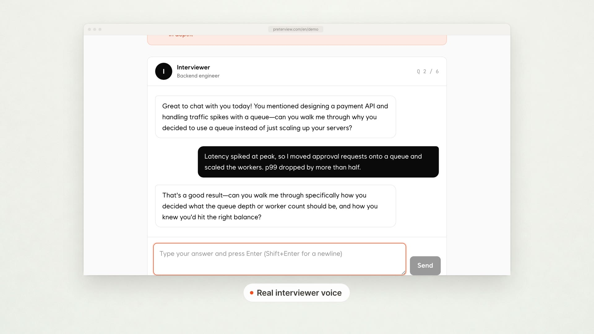

My new prompt won 63% of the time. I had the Slack message half-typed. Then I swapped which answer went first, ran the exact same 400 comparisons again, and the new prompt won 43%.

Same judge. Same pairs. Same rubric. The only change was which answer appeared under "Response A". That is **LLM-as-a-judge position bias**, and it had been quietly deciding my A/B tests for weeks.

## TL;DR

- I ran 400 pairwise comparisons with Claude as the judge, then ran all 400 again with the answer order swapped. 800 judge calls total.
- **103 of 400 verdicts (25.75%) flipped** when I swapped the order. 92 of those flips went to whichever answer was shown first.
- The new prompt looked like a 63% winner. Counting only verdicts that survived the swap, it won 160 to 137, about 54%. A small edge, not a landslide.
- On a blind sample I labeled myself, most flipped pairs were ones I'd call a tie. A flip is the judge's way of saying "I can't tell."
- Fix: always judge both orders, treat disagreement as a tie, and give the judge an explicit TIE option.

## What was I actually testing?

I was A/B testing two versions of a report-writing prompt. The system takes an interview transcript and writes a feedback report: what went well, what was weak, what to practice next.

This is the report generator inside Preterview, an interview prep tool I built and run (full disclosure: I built it). It runs voice mock interviews with three interviewer styles, scores a resume or portfolio, and ends with a written report, which is the part I was trying to improve. If you want to see what the reports look like, it's at [preterview.com/en](https://preterview.com/en).



Prompt v2 was supposed to make reports more specific: quote the candidate's actual words, tie every criticism to a moment in the transcript. I generated reports from v1 and v2 for the same 400 transcripts, then asked Claude to pick the better one.

The obvious setup: new report in slot A, old report in slot B, ask "which is better?" One order, one verdict per pair. That single fixed order is exactly why v2 looked so good.

## What is LLM-as-a-judge position bias?

LLM-as-a-judge position bias is the tendency of a model acting as an evaluator to prefer an answer because of where it appears in the prompt, not because of what it says. In pairwise comparisons, the judge favors slot A or slot B more often than the content justifies. It's a well-documented effect in the LLM evaluation literature, and I still walked straight into it.

The nasty part is that each individual verdict looks reasonable. The judge writes a confident paragraph explaining why Response A is more specific. You read it and nod. Nothing in a single output tells you the reasoning was built after the slot already won.

## How did I measure it?

I ran every pair twice: once with v2 in slot A, once with v2 in slot B. Same system prompt, same rubric, forced choice between A and B. Here's the core of the harness:

```python
import anthropic

client = anthropic.Anthropic()

JUDGE_PROMPT = """You are grading two interview feedback reports
written for the same transcript. Judge on: specificity (quotes
the candidate's words), accuracy (claims match the transcript),
and actionability (clear next steps).

<transcript>{transcript}</transcript>
<response_a>{a}</response_a>
<response_b>{b}</response_b>

Reply with exactly one line: WINNER: A or WINNER: B"""

def judge(transcript, a, b):
    msg = client.messages.create(
        model=JUDGE_MODEL,
        max_tokens=20,
        messages=[{"role": "user", "content": JUDGE_PROMPT.format(
            transcript=transcript, a=a, b=b)}],
    )
    return msg.content[0].text.strip().split()[-1]  # "A" or "B"

def judge_both_orders(transcript, old, new):
    first = judge(transcript, a=new, b=old)    # new in slot A
    second = judge(transcript, a=old, b=new)   # new in slot B
    new_won_1 = first == "A"
    new_won_2 = second == "B"
    if new_won_1 and new_won_2:
        return "new"
    if not new_won_1 and not new_won_2:
        return "old"
    return "flip"
```

Each call carried a transcript excerpt plus two full reports, roughly 5,200 input tokens. 800 calls came to about 4.2M input tokens. Not free, but cheap next to shipping the wrong prompt to every user.

## How many verdicts flipped when I swapped the order?

103 of 400 verdicts flipped, a 25.75% flip rate. One in four comparisons gave a different winner depending only on which report was printed first.

Here's the full breakdown:

| Outcome | Pairs |
|---|---|
| v2 wins in both orders | 160 |
| v1 wins in both orders | 137 |
| Flipped toward slot A | 92 |
| Flipped toward slot B | 11 |
| **Total** | **400** |

So the flips weren't random noise. 92 of 103 went to whoever sat in slot A. If the judge were just uncertain and guessing, you'd expect something close to a 50/50 split between the two flip directions. 92 to 11 is a thumb on the scale.


Now look at what that did to the headline numbers:

- **Run 1 (v2 in slot A):** v2 won 252 of 400. That's 160 consistent wins plus 92 slot-A flips. 63%.
- **Run 2 (v2 in slot B):** v2 won 171 of 400. That's 160 plus the 11 slot-B flips. 42.75%.
- **Swap-consistent only:** v2 won 160, v1 won 137. 53.9% of decided pairs.

My first run happened to put v2 in slot A. I was about to announce a 63% win rate for a prompt whose real edge was closer to 54%. If I'd randomly done it the other way around, I would have thrown out a prompt that was actually slightly better.

## Are flipped verdicts just ties in disguise?

Mostly, yes. I took 50 random pairs, hid which prompt produced which report, and picked the winner myself before looking at any judge output.

- 13 of the 50 had flipped verdicts, which tracks the 26% overall rate.
- On the 37 pairs with a swap-consistent verdict, the judge agreed with me on 31 (84%).
- Of the 13 flipped pairs, I marked 9 as "honestly, these are about the same."


That changed how I read the whole result. Position bias doesn't mostly override clear quality differences. It fills the vacuum when there isn't one. When two reports are close, the judge needs some tiebreaker, and the tiebreaker it reaches for is "the first one I read."

Which means a forced-choice prompt is lying to you twice. It hides ties, and then it resolves those hidden ties in a biased direction.

## Does adding a TIE option fix position bias?

It helps a lot but doesn't eliminate it. I changed the output line to `WINNER: A`, `WINNER: B`, or `WINNER: TIE` and reran all 400 pairs in both orders.

- 88 pairs got a TIE in at least one order.
- Strict flips, where one order said A and the other said B, dropped from 103 to 31.

31 is still 31. The judge is still nudged by order on close calls, it just has a more honest exit now. That's why I don't trust a tie option by itself. The swap is the part that does the real work.

## How should you run pairwise LLM evals now?

Here's my current setup, and it's the one I'd recommend to anyone A/B testing prompts with a model as the grader:

1. **Always judge both orders.** It doubles the cost. Pay it. A single-order pairwise eval tells you about slot preference as much as about quality.
2. **Count a flip as a tie.** Only swap-consistent verdicts go in the win column. Report the tie count next to the win rate so nobody reads 54% as 54-out-of-100-decisive.
3. **Offer an explicit TIE.** It catches the close calls before they become flips.
4. **Hand-label a small blind sample.** 50 pairs took me under an hour and told me more than the other 750 calls about what the judge's disagreement meant.
5. **Track the flip rate as a metric.** If it jumps after you edit the judge prompt, your judge got worse, even if the win rates look exciting.

The thing I keep coming back to: none of this showed up in any single output. Every verdict came with a tidy justification. The bias only appeared when I ran the same question twice and compared.

## So how bad is LLM-as-a-judge position bias with Claude?

In my setup, bad enough to flip a decision. Swapping answer order changed the winner on 103 of 400 pairwise comparisons (25.75%), and 92 of those flips favored the answer shown first. It turned a real 54% edge into either a 63% win or a 43% loss depending on which slot the new prompt landed in. The flips clustered on pairs that were close in quality, so the fix is cheap and mechanical: run every comparison in both orders, count disagreements as ties, give the judge a TIE option, and spot-check a blind sample by hand. If your LLM-as-a-judge eval only runs one order, your win rate is partly measuring position.

---

*Written by the developer behind [Preterview](https://preterview.com/en), an interview prep platform.*
