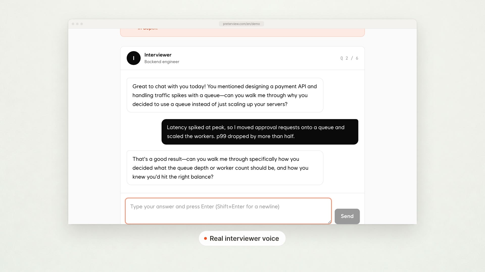

A 20-minute Korean voice session should cost about the same to score as a 20-minute English one. Mine cost more than twice as much, and for three months I assumed that was just "how Korean tokenizes."

It wasn't. It was one default argument: `json.dumps` with `ensure_ascii=True`. Every Hangul syllable in my transcripts was reaching Claude as a six-character `\uXXXX` escape, and I was paying for every one of those characters as tokens.

This post is the autopsy: how I found it, what I measured across 500 replayed scoring calls, and the two smaller bugs the fix caused.

## TL;DR

- **Python's `json.dumps` defaults to `ensure_ascii=True`**, which rewrites every non-ASCII character as `\uXXXX`. One Korean syllable becomes 6 ASCII characters.
- **This only costs you tokens when you paste the JSON string into prompt text.** Sending JSON over HTTP is fine, because the server decodes it before the model sees anything.
- In my scoring pipeline, the transcript section shrank **3.4x** after the fix and total input tokens per call dropped from **11,400 to 4,900 on average (2.3x)**.
- Quotes in the written reports got more accurate too: reports with a garbled quote went from **41 of 500 to 6 of 500**.
- Fix: `json.dumps(obj, ensure_ascii=False)`, plus a test that fails if `\u` appears in any rendered prompt.

## Where did the escapes come from?

The escapes came from my own prompt builder, not from the Anthropic SDK. The scoring step takes a list of interview turns and builds a user message like this:

```python
import json

def build_scoring_prompt(turns: list[dict], rubric: str) -> str:
    return (
        f"{rubric}\n\n"
        f"<transcript>\n{json.dumps(turns, indent=2)}\n</transcript>\n\n"
        "Score the candidate and quote their exact words as evidence."
    )
```

Looks harmless. Here is what one turn actually looked like inside that string:

```json
{
  "speaker": "candidate",
  "text": "\uc800\ub294 \ubc31\uc5d4\ub4dc \uac1c\ubc1c\uc790\ub85c 3\ub144 \uc77c\ud588\uc2b5\ub2c8\ub2e4"
}
```

That is "I worked as a backend developer for 3 years" in Korean. 15 Hangul syllables became 90 characters of hex soup. The model can read it, mostly. The tokenizer, on the other hand, sees a long run of backslashes, letters and digits with no common words in it, and chops it into many small pieces.

## Does json.dumps ensure_ascii affect LLM token count?

Yes, but only in one specific situation: when the output of `json.dumps` ends up inside the text the model reads. With `ensure_ascii=True` (the default), any non-ASCII character becomes a `\uXXXX` escape, and that escape costs several tokens instead of the one or two the raw character would.

It does **not** matter when JSON is just the transport. The SDK serializes your `messages` payload, the API decodes it, and the model sees real characters. I checked this first because I didn't want to chase the wrong layer:

```python
client.messages.count_tokens(
    model=MODEL,
    messages=[{"role": "user", "content": korean_answer}],  # a raw Hangul string
)
```

Same count whether the HTTP body had escapes or not. The bug lives exactly where JSON-as-a-string meets your f-string.

It also isn't a Korean-only problem. Anything outside ASCII gets the same treatment:

| Input | ensure_ascii=True | Characters |
|---|---|---|
| `é` | `\u00e9` | 1 → 6 |
| Hangul syllable (U+C800) | `\uc800` | 1 → 6 |
| `😀` | `\ud83d\ude00` | 1 → 12 |

Spanish accents, Japanese, Chinese, emoji in a chat log. All of it inflates.


## How did I find it?

I found it by comparing two sessions that should have been twins. One English session and one Korean session, both about 20 minutes, both roughly 30 turns. The English transcript section came in around 3,000 tokens. The Korean one was over 10,000.

My first theory was the tokenizer. Korean does usually cost more tokens per word than English, so a gap was expected. But 3x? I printed the rendered prompt instead of reading my code, and the backslashes were right there on the first screen.

Lesson I keep relearning: **log the final string you send, not the objects you built it from.** I had logged `turns` for months. It looked perfect, because Python prints Korean just fine. The damage only existed in the serialized form.

## What did I measure?

This pipeline is the scoring step of Preterview, an interview-practice app I run (full disclosure: I built it). After a voice session ends, the transcript plus a rubric goes to Claude, which returns scores and a written report that quotes the candidate's own answers as evidence. You can see what a session looks like at [preterview.com/en](https://preterview.com/en).



To size the damage, I took 500 stored Korean scoring requests and rebuilt each prompt twice, once with the old builder and once with `ensure_ascii=False`. Then I ran both versions through `count_tokens` and re-ran the actual scoring call on both.

Results:

- **Transcript section only:** 3.4x larger with escapes.
- **Whole prompt (English rubric + system prompt + transcript):** 11,400 vs 4,900 input tokens on average, 2.3x.
- **Input token spend on the scoring step:** down about 57% after the fix, with no change in session volume.
- **Longest session:** went from uncomfortably close to my self-imposed context budget to well under half of it.

The overall number is lower than 3.4x because the rubric and instructions are English and were never affected. If your prompt is mostly non-ASCII user content, expect a bigger multiplier than mine.

## Did the escapes hurt output quality?

They did, and this surprised me more than the bill. My reports quote the candidate verbatim ("You said: ..."). I wrote a checker that takes each quoted span and searches for it in the decoded transcript.

- **With escapes:** 41 of 500 reports had at least one quote that didn't match the transcript. Usually one wrong syllable, occasionally a word that sounded similar but was not what the candidate said.
- **Without escapes:** 6 of 500.

My read is that the model was decoding hex in its head while also scoring, summarizing and writing, and sometimes it decoded a neighbor code point. I can't prove that's the mechanism for every case, and some of the remaining 6 are plain paraphrase. But a 7x drop in misquotes from changing nothing except the encoding is hard to argue with. For a product whose whole point is "here is exactly what you said," a wrong syllable is a real bug.

## How do you fix it?

Pass `ensure_ascii=False` everywhere JSON gets embedded in prompt text:

```python
def to_prompt_json(obj) -> str:
    return json.dumps(obj, ensure_ascii=False, indent=2)
```

I made it a single helper so nobody (me, at 1 a.m.) reaches for bare `json.dumps` in prompt code again. Then I added a test that renders every prompt template with a non-ASCII fixture:

```python
import re

ESCAPE = re.compile(r"\\u[0-9a-fA-F]{4}")

def test_prompts_have_no_unicode_escapes():
    # Hangul written as escapes in source; real characters at runtime
    turns = [{"speaker": "candidate", "text": "\uc800\ub294 café 😀"}]
    for name, build in PROMPT_BUILDERS.items():
        rendered = build(turns, rubric="...")
        assert not ESCAPE.search(rendered), f"{name} leaked \\uXXXX escapes"
```

That fixture deliberately includes Hangul, an accented Latin letter and an emoji, because each one has caught a different code path for me.

While you're in there, consider whether you need `indent=2` at all. Indentation is whitespace the model pays for. I kept it for the transcript because it helped the model keep speakers straight, but I dropped it from two metadata blocks where it bought nothing.

## What broke after the fix?

Two things, both small, both annoying.

**1. A Windows file write started crashing.** A debug script dumped prompts to disk with `open(path, "w")`. With escapes, the content was pure ASCII and any encoding worked. Without escapes, it hit the default locale encoding on a teammate's Windows machine and raised `UnicodeEncodeError`. Fix: `open(path, "w", encoding="utf-8")`. Always. ASCII escaping had been hiding a missing `encoding=` for months.

**2. Prompt cache hit rate went to zero for about an hour.** Changing the transcript encoding changed the bytes of every prompt, so every cached prefix was invalid. Expected and harmless, but if you watch cache metrics, warn whoever gets the alert before you deploy.

## Should you always use ensure_ascii=False?

For prompt text, yes. For other places, think for a second:

- **HTTP bodies, files read by other programs:** either setting is valid JSON. Pick `False` with explicit UTF-8 if you want readable logs.
- **Systems that choke on non-ASCII** (some old log shippers, certain headers): keep `True` there. That's what the default exists for.
- **Anything a model will read as text:** `False`. The model reads characters, not escapes, and you pay per token.

A quick grep finds the suspects in about ten seconds:

```bash
grep -rn "json.dumps" --include="*.py" | grep -v "ensure_ascii=False"
```

In my repo that returned 14 hits. 3 of them fed prompts. The other 11 were fine as they were.

## So why did json.dumps ensure_ascii make my Claude prompts 2.3x bigger?

Because Python's `json.dumps` defaults to `ensure_ascii=True`, which turns every non-ASCII character into a `\uXXXX` escape, and I was pasting that string straight into prompt text. Each Korean syllable became six ASCII characters that tokenize into several tokens, so the transcript section grew 3.4x and the whole scoring prompt grew from 4,900 to 11,400 input tokens on average. The escapes also made the model misquote candidates more often (41 vs 6 bad reports out of 500). Setting `ensure_ascii=False` for any JSON that ends up inside a prompt, plus a test that fails on `\u` escapes in rendered prompts, fixed both problems.

---

*Written by the developer behind [Preterview](https://preterview.com/en), an interview prep platform.*
